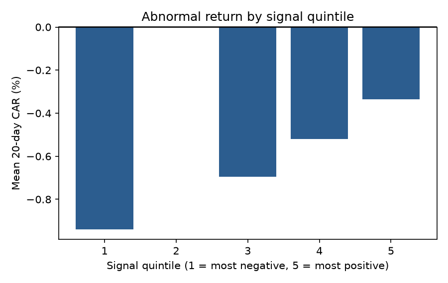
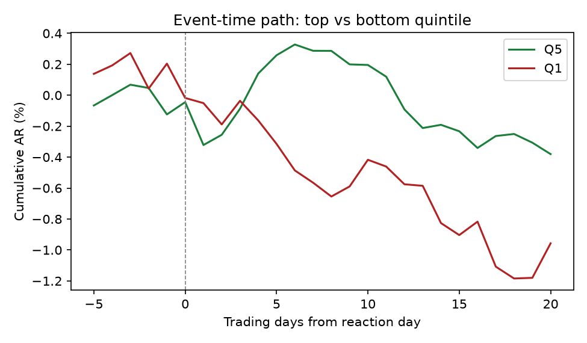
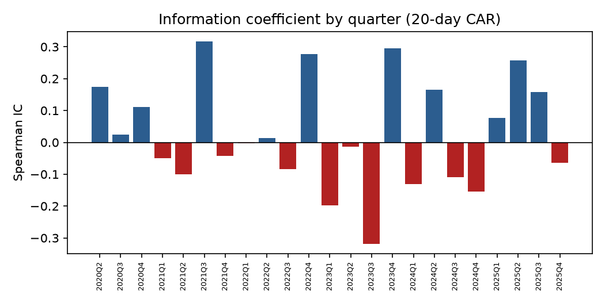
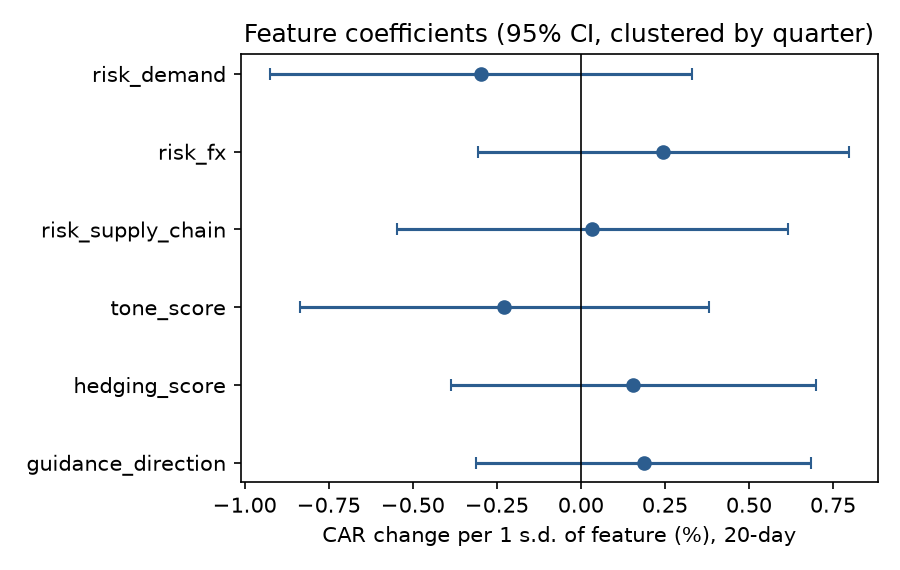

# Do Changes in Filing Language Predict Stock Returns?

An end-to-end NLP event study on SEC filings. **Finding: with a word-list baseline on 30 large-cap US stocks, no statistically significant predictive signal.** The value of the project is the pipeline and the way the test was done, not a trading edge.

## What it does

1. **Downloads** 10-K and 10-Q MD&A sections and 8-K earnings press releases from SEC EDGAR.
2. **Scores** each document on six features: guidance direction, hedging, tone, and supply-chain, FX and demand-risk emphasis. Scores are cached in SQLite. A lexicon (word-list) extractor was used for the results below. An LLM extractor is also implemented but was not run.
3. **Builds a signal** from the quarter-over-quarter change in each feature, standardised within document type and calendar quarter. The expected sign of each feature was fixed before looking at returns, so nothing in the composite is fitted to the data.
4. **Runs an event study:** market-model abnormal returns versus SPY (estimated on days -250 to -30) over 1, 5 and 20 trading days, starting from the first tradable session after the SEC acceptance time.
5. **Tests the signal:** long-short quintile spreads per quarter, Spearman rank information coefficient (IC), regression with errors clustered by quarter, an out-of-sample check (split 2022-01-01), and a flat 10 bps per-leg cost.

## Data

30 large-cap US stocks, filings from January 2020: 667 events from 10-K/10-Q filings and 369 from earnings releases, 1,036 in total.

## Results

IC = rank correlation between signal and abnormal return. LS = long-short (top minus bottom quintile) spread. OOS IC = out-of-sample IC after the split date. LS is n/a for releases because no quarter had enough events to form five groups.

| Run | Horizon | Events | IC | IC t | LS gross | LS t | OOS IC |
|---|---|---|---|---|---|---|---|
| All filings, skip reaction day | 1d | 1,036 | -0.02 | -0.65 | -0.23% | -1.35 | -0.02 |
| All filings, skip reaction day | 5d | 1,036 | 0.03 | 0.86 | 0.59% | 1.68 | 0.03 |
| All filings, skip reaction day | 20d | 1,031 | 0.03 | 0.74 | 0.57% | 0.85 | -0.01 |
| All filings, include reaction day | 1d | 1,036 | 0.00 | 0.12 | 0.30% | 0.61 | -0.02 |
| All filings, include reaction day | 5d | 1,036 | 0.04 | 0.89 | 0.62% | 0.94 | 0.01 |
| All filings, include reaction day | 20d | 1,031 | 0.05 | 1.35 | 1.15% | 1.59 | 0.01 |
| Earnings releases only | 1d | 369 | -0.01 | -0.31 | n/a | n/a | 0.01 |
| Earnings releases only | 5d | 369 | 0.02 | 0.31 | n/a | n/a | -0.01 |
| Earnings releases only | 20d | 367 | 0.05 | 0.89 | n/a | n/a | 0.00 |
| 10-K/10-Q only | 1d | 667 | -0.02 | -0.58 | -0.37% | -1.72 | -0.02 |
| 10-K/10-Q only | 5d | 667 | 0.04 | 0.97 | 0.45% | 1.03 | 0.04 |
| 10-K/10-Q only | 20d | 664 | 0.02 | 0.41 | 0.48% | 0.67 | -0.01 |

**Reading it:** no t-statistic exceeds 2 in absolute value, signs flip across horizons and subsets, and out-of-sample IC is about zero. Including the reaction day roughly doubles the 20-day spread, as expected, because it adds the part of the move that cannot realistically be traded, but even that is not significant. This is a finding about this design (a crude text measure on a small sample of efficient stocks), not proof that filing language never matters.

### Figures

Copy the four charts from your run's `outputs` folder into a `results/` folder:






## Validation

- 12 automated tests, including event-timing rules, abnormal-return calculation, quarter-over-quarter differencing, the quintile/IC/regression logic, and LLM-response parsing.
- An offline synthetic demo with a **planted** effect: the pipeline recovers it (20-day IC about 0.12, holds out of sample), and with the effect set to zero it finds nothing. This proves the machinery works; it says nothing about real markets.

## Limitations

1. **Low power.** About 1,000 events cannot detect small effects, so a small true effect is not ruled out.
2. **Incomplete release coverage.** Earnings releases were found by a filename heuristic, and 369 is probably well below the true count. The updated code reads each filing's index page instead, but that change was tested only on a sample page, not live.
3. **Survivorship bias.** The universe is today's large caps.
4. **Timing.** 10-K/10-Q filings often arrive after the earnings release, so much of the news is already in the price.
5. **Crude text measures.** Word lists ignore negation and context.
6. **Multiple testing.** Four runs and three horizons were examined; none was significant even before any correction.
7. **Simplified costs.** Flat 10 bps per leg; no borrow costs or capacity analysis.
8. **No transcripts.** There is no free source for full earnings-call transcripts. The pipeline accepts files you supply.

## Run it

```bash
pip install -r requirements.txt
python -m pytest -q tests                      # 12 tests
python -m nlp_signal.cli demo                  # offline synthetic run

set "SEC_USER_AGENT=Your Name your@email.com"  # Windows; the SEC requires this
python -m nlp_signal.cli ingest -n 30 --start 2020-01-01
python -m nlp_signal.cli extract --extractor lexicon
python -m nlp_signal.cli analyze --extractor lexicon --offset 1
```
Other useful options: `--sources release` or `periodic`, `--offset 0`, `--cost-bps`, `--out folder`, and `extract --extractor llm --dry-run` to estimate LLM cost before spending anything.

## Layout

```
nlp_signal/   edgar, textproc, extract, signals, event_study, analysis, report, pipeline, cli
tests/        unit and end-to-end tests
notebooks/    results.ipynb
docs/         write-up
```

## Next steps

Verify release coverage with the `coverage` command, scale to about 100 companies, run the LLM extractor on earnings releases and test whether it beats the word-list baseline, and add licensed transcripts.
